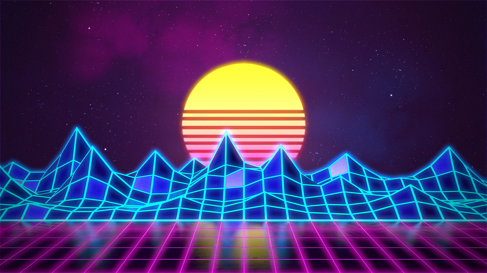

# Vaporwave

A dark Omarchy theme inspired by vaporwave sunsets and neon-soaked nights. Deep
aubergine surfaces and soft lavender text keep the desktop comfortable to read,
while hot pink, cyan, and sunset gold bring the color.



## Install

Install from GitHub with Omarchy:

```bash
omarchy theme install https://github.com/signaldirective/vaporwave
omarchy theme set vaporwave
```

Or clone the repository into `~/.config/omarchy/themes/vaporwave/` and select
it with `omarchy theme set vaporwave`.

## What's included

- Eight vaporwave-inspired wallpapers.
- A complete dark palette for Omarchy and terminal applications.
- A pink-to-cyan active window-border gradient.

## Note on Hyprland Lua

The `hyprland.lua` file documents this theme's window-border colors. Omarchy
does not load Lua files from themes installed from Git repositories, so apply
those settings manually if you want the themed Hyprland borders.

Apply with:

```bash
omarchy theme set vaporwave
```
